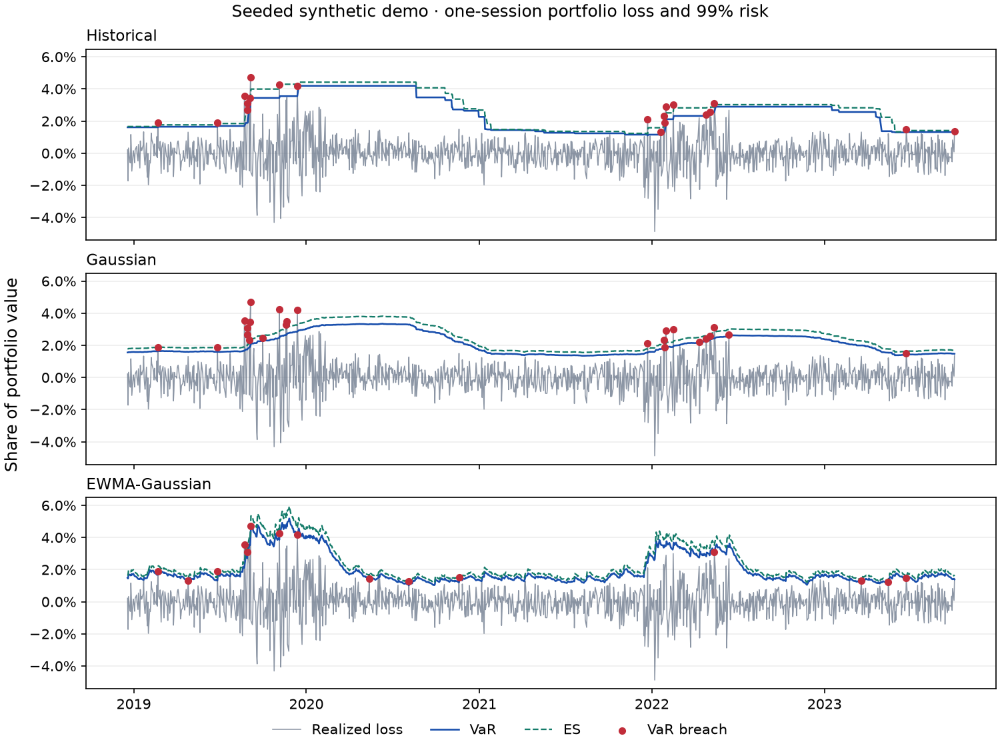

# Multi-Asset Risk Engine

A Python research engine for one-session portfolio VaR and Expected Shortfall
(ES), rolling backtests, volatility attribution, and stress testing.

[](https://github.com/ygndev/multi-asset-risk-engine/actions/workflows/ci.yml)
[](https://github.com/ygndev/multi-asset-risk-engine/blob/main/LICENSE)

## Market study at a glance

The 2010–2024 study used a daily rebalanced portfolio of 50% IVV, 30% IEF,
and 20% IAU. Each model produced 3,523 out-of-sample forecasts with a
250-return window at 99% confidence.

| Model | VaR breaches | Observed rate | Nominal expected breaches | Kupiec p-value |
| --- | ---: | ---: | ---: | ---: |
| Historical | 49 | 1.39% | 35.23 | 0.0277 |
| Gaussian | 76 | 2.16% | 35.23 | 2.185e-09 |
| EWMA-Gaussian | 67 | 1.90% | 35.23 | 1.72e-06 |

The tests use a nominal **1% breach rate**. With 250 past observations, the
historical VaR is the third-largest loss. Under independent, identically
distributed continuous losses, the next loss exceeds that estimate with
probability **3/251 ≈ 1.195%**. This is a theoretical benchmark.

The baseline had cumulative losses of 4.15% in March 2020 and 13.27% in 2022.
These findings describe one research portfolio and snapshot. [Study setup and limitations](docs/market-study.md) · [Stress testing](docs/stress-testing.md)



Seeded synthetic data. The red markers show realized losses above the
corresponding VaR forecast. [Reproduce the figure](docs/methodology.md#reproduce-the-synthetic-figure)

## Quick start

Use Python 3.11 or newer. Create a virtual environment from the repository root.

```sh
python -m venv .venv
```

Activate it with `.\.venv\Scripts\Activate.ps1` in PowerShell or
`source .venv/bin/activate` in a POSIX shell, then run the offline demo.

```sh
python -m pip install .
risk-engine demo
```

[Reference demo output](examples/synthetic-risk-report.md) · [Windows troubleshooting](docs/methodology.md#windows-troubleshooting)

## Documentation

- [Methodology](docs/methodology.md) covers portfolio returns, VaR/ES estimators, coverage tests, and the synthetic demo.
- [Market study](docs/market-study.md) covers the price schema, snapshot provenance, backtests, and volatility attribution.
- [Stress testing](docs/stress-testing.md) covers historical replay, shock configuration, and weight sensitivity.

For the complete offline test suite, run `python -m pip install ".[market,test]"`
and `python -m pytest -q`. CI covers Python 3.11–3.15 on Linux.

The code uses the [MIT License](LICENSE). Third-party market data remains
subject to its provider's terms.
